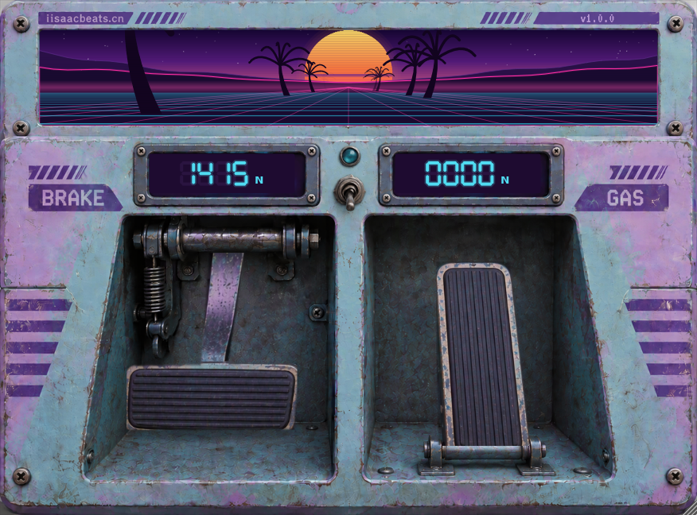

<h1 align="center">Break</h1>

<p align="center"><strong>蒸汽波踏板 · 整台机器是一台磁带机</strong></p>

<p align="center">
  <em>油门 · 刹车 · 磁带机走带机构</em><br>
  <em>Gas · Brake · Tape Machine</em>
</p>

<p align="center">
  
  
  
</p>

<p align="center">
  <code>░▒▓ SYNTHWAVE ▓▒░</code><br>
  <code>gas ░ brake ░ tape stop ░ palm trees</code>
</p>

---

## 概述 / Overview

**Break** 把整台效果器做成一台磁带机，所有控制都压在两个踏板上，没有其它旋钮或按钮：**油门**让磁带加速（音高上扬、变亮、磁带饱和推进），**刹车**让磁带减速直至彻底停转（音高下滑、wow/flutter 加剧、高频丢失、摩擦啸叫），两踏板都松开时**直接旁通**（输出 = 输入，0 延迟）。顶部的 Synthwave 场景和两块七段数码管读数，都是程序绘制、实时响应的。

> **中文**：一款蒸汽波（Vaporwave）风格的踏板效果器。核心是**真·varispeed 走带机构**（读写头分离 + 分数插值，时长真的被拉长/压缩，不是 pitch shifter），加速时的"片段重复"按宿主 BPM 对齐回卷。界面是一个 1168×864 的踏板机：渐变落日、线框山脉、透视霓虹网格与随前进距离掠过的棕榈树，全部由 `SynthwaveScene.h` 程序绘制。

> **English**: A vaporwave-styled pedal effect built around a real tape transport. The whole machine is a tape deck with two pedals — **gas** speeds the tape up (pitch up, brighter, more saturation), **brake** slows it down to a full tape stop (pitch down, wow/flutter, HF loss, scrape noise). Releasing both pedals bypasses the DSP completely (output = input, zero latency). The UI is a procedurally-drawn pedal machine: a gradient sunset, wireframe mountains, a perspective neon grid, and palm trees that recede as you move forward.

> 分类 Category：Fx / Lo-Fi / Tape ｜ 插件代码 Plug-in Code：`Brk1` ｜ 厂商 Vendor：iisaacbeats.cn

---

## 预览 / Preview

<p align="center">
  
</p>

<p align="center">
  <code>左侧刹车 ░ 右侧油门 ░ 中间锁定拨杆 ░ 顶部 Synthwave 场景</code><br>
  <em>brake on the left — gas on the right — lock switch in the middle — synthwave scene on top.</em>
</p>

---

## 功能模块 / Modules

| 模块 / Module | 功能描述 / Description |
|------|---------|
| **走带机构 DSP** | **真 varispeed**：4 秒环形缓冲读写分离，4 点 Catmull-Rom 分数插值，时长真的被拉伸/压缩。加速回卷按**宿主 BPM 对齐**（片段重复落在节拍上）。<br>*Real varispeed: split read/write heads with 4-point Catmull-Rom interpolation; the tape really stretches/compresses time. Speed-up rewinds are BPM-aligned to the host.* |
| **静止旁通 Bypass** | 两踏板松开且已回位 → 30ms 等功率交叉淡化切到**纯旁通**（0 延迟、逐比特等于输入）；松手瞬间读头立即重置。<br>*At rest, crossfade to a true bypass (zero latency, bit-identical output); the read head resets instantly on release.* |
| **油门踏板 Gas** | 走带加速 1→2^0.5，音高上扬 +6 半音；tilt 提亮 +5.5dB、去隆隆声、磁带饱和推进。<br>*Speeds the tape up to 2^0.5 (pitch +6 semitones), brightens via tilt EQ and drives the tape saturation.* |
| **刹车踏板 Brake** | 走带减速 1→2^-4.6（speed≈0.041），音高下滑 -4.6 八度；tilt 压暗 -7.5dB、磁头低通 17k→260Hz、wow/flutter 加重 + 摩擦啸叫，满刹淡出到静音（磁带停转）。<br>*Slows the tape to 2^-4.6 (−4.6 octaves), darkens, adds wow/flutter and scrape, fading to silence at full stop.* |
| **刹车优先 Brake-priority** | 油门 + 刹车同时踩下时，**只有刹车生效**（油门视为 0）。<br>*When both are pressed, only the brake is applied.* |
| **锁定拨杆 Lock switch** | 两块数码屏之间的拨杆：开启后踩下踏板**松手不自动回弹**（力度保持），关闭立即回弹。<br>*A switch between the two readouts locks the pedals (no spring-back on release).* |
| **Synthwave 场景** | 渐变天空、闪烁星空、条纹落日、双层线框山脉、透视霓虹网格、**随前进距离掠过的棕榈树**（左右独立随机间距，从极远处淡入）。<br>*Gradient sky, twinkling stars, striped sun, wireframe mountains, neon grid, and palm trees that fade in from the distance.* |
| **双时间轴** | `beatPhase`（BPM）驱动太阳/条纹；`travel`（前进距离）由**两个踏板**驱动（满刹停止、满油门加速），网格与棕榈树随之滚动。<br>*Two timelines: BPM drives the sun, pedals drive forward motion (grid + palms).* |
| **七段数码管** | 程序绘制 4 位读数 + 单位 N，力度→牛顿线性映射（刹车 0–2000N / 油门 0–1000N）。<br>*Procedural 7-seg readouts with a force-to-newton mapping.* |
| **自动化 Automation** | `gasForce` / `brakeForce` 两个参数暴露给宿主（0..1）。<br>*Two host-automatable parameters.* |

---

## 技术栈 / Tech Stack

| 项目 / Item | 版本 / Version |
|------|------|
| 语言 Language | C++17 |
| 框架 Framework | [JUCE](https://juce.com) 8.0.12（FetchContent 自动拉取） |
| 构建 Build | CMake ≥ 3.22 |
| 格式 Formats | VST3 · AU · Standalone |
| 安装器 Installer | Inno Setup 6（Windows）／ pkgbuild + productbuild（macOS） |

---

## 构建 / Build

```bash
# 克隆仓库 Clone
git clone https://github.com/sweetorange1/Break.git
cd Break
```

**Windows**（推荐用 `build.ps1`，自动用 vswhere 探测 MSVC + Windows SDK + 本地 JUCE 源码）：

```bash
powershell -NoProfile -ExecutionPolicy Bypass -File "build.ps1"              # 全量
powershell -NoProfile -ExecutionPolicy Bypass -File "build.ps1" -Target Break_VST3
```

**macOS**（Xcode 生成器，通用二进制）：

```bash
cmake -S . -B cmake-build-release -G Xcode \
  -DCMAKE_BUILD_TYPE=Release \
  -DCMAKE_OSX_ARCHITECTURES="x86_64;arm64" \
  -DFETCHCONTENT_SOURCE_DIR_JUCE=<你的 JUCE 源码目录>
cmake --build cmake-build-release --config Release
```

产物 Output：`cmake-build-*/Break_artefacts/Release/{Standalone,VST3,AU}`。

> 网络后端说明：遥测 / 更新检查走 JUCE 默认原生后端（Windows = WinHTTP，macOS = NSURLSession），**不需要 CURL**。

## 打包安装器 / Packaging

```bash
# Windows —— 需要先安装 Inno Setup 6 / Requires Inno Setup 6
build_installer.bat
# 产物 Output：dist\Break_Setup_1.0.0_x64.exe

# macOS —— 需先用 Release 构建 VST3 + AU 目标
chmod +x build_installer_mac.sh
./build_installer_mac.sh          # pkg + dmg
./build_installer_mac.sh --no-dmg # 仅 pkg only
# 产物 Output：dist\Break_Setup_1.0.0_macOS.pkg / .dmg
```

Windows 安装器把 VST3 装入 `C:\Program Files\Common Files\VST3\iisaacbeats.cn`（需管理员权限）；macOS 安装器提供 VST3（`/Library/Audio/Plug-Ins/VST3`）与 AU（`/Library/Audio/Plug-Ins/Components`）两个可选组件。

---

## 隐私说明 / Privacy

- **更新检查 Update check**：启动后异步请求 `iisaacbeats.cn` 一次（5s 超时，失败静默），仅在有新版本时弹窗提示。
  *Async check to `iisaacbeats.cn` on startup (5s timeout, silent on failure); prompts only when a new version exists.*
- **匿名遥测 Telemetry**：每日一次匿名的"界面打开"事件（无任何音频数据、无个人身份信息），客户端为随机 UUID。
  *Anonymous "ui opened" event once per day (no audio, no PII), random client UUID.*
- 停用遥测 Disable telemetry：启动前设置环境变量 `IISAAC_TELEMETRY_DISABLED=1`。
  *Set `IISAAC_TELEMETRY_DISABLED=1` before launch.*

---

## 工程笔记 / Engineering Notes

开发中踩过的坑，改代码前务必先看（详见 git 历史）：

- 静止状态必须**逐比特等于输入**：所有滤波器都用**并联混合**介入（`y += mix*(filtered - y)`），wow/flutter 深度不能留常数项。
- **松手瞬间读头立即重置**（`wasPedalDown && !pedalDown`），否则音高恢复会带"追带"加速尾巴。
- 加速回卷调度在**节拍边界**执行；回卷淡化期间禁止再次调度（防双重回卷）。
- **宿主自动化 ≠ 编辑器写回**：只在 `editorDriving`（用户拖动/回弹）时写回参数，否则与音频线程竞态覆盖宿主曲线。
- `repaint` 区域必须覆盖"上一帧 ∪ 当前帧"，且每踏板独立记录，否则局部重绘漏区 → 残影。
- 4 点单应插值采样的是**预乘 ARGB**，插值后不要再 `premultiply()`（双重预乘压黑半透明边缘）。
- 锁定态只贴 `switch_on.png` 小块图（96×150），始终画未锁定底图，避免两张 AI 底图整图色调跳变、也减小包体。

---

## 许可 / License

业务代码版权归 iisaacbeats.cn 所有。
*The DSP/UI/network code is © iisaacbeats.cn.*

第三方组件 Third-party：

| 组件 / Component | 许可 / License |
|------|------|
| JUCE 8 | GPL-3.0 / 商业双授权 GPL-3.0 / commercial dual |

---

<p align="center">
  <code>░▒▓ GAS ░ BRAKE ░ TAPE STOP ▓▒░</code><br>
  <em>让声音在磁带上慢下来。</em><br>
  <em>Let the sound slow down on the tape.</em><br><br>
  &copy; 2024-2026 iisaacbeats.cn
</p>
